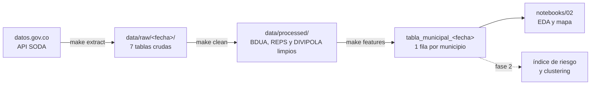
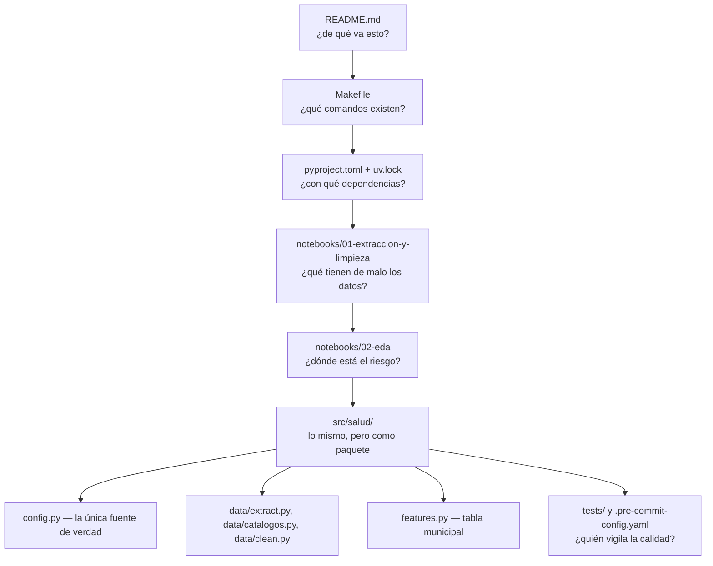

# Riesgo de acceso a la salud por municipio en Colombia

Proyecto 2 · Especialización en Ciencia de Datos e IA.

**Objetivo.** Identificar y priorizar los municipios de Colombia con mayor riesgo
de que su población se quede sin acceso a la salud, por **depender de EPS
intervenidas** y contar con **poca oferta de IPS**.

Este repositorio contiene la **fase 1** (extracción, limpieza, integración y EDA)
organizada con las prácticas del curso de MLOps: entorno reproducible con `uv`,
comandos en un `Makefile`, código como paquete en `src/`, una sola fuente de
verdad para los parámetros, datos crudos versionados por fecha y hooks que
vigilan cada commit.

Este es el flujo de datos:



## Fuentes (datos abiertos, licencia CC BY-SA 4.0)

| Base | Entidad | ID en datos.gov.co | Uso |
|---|---|---|---|
| BDUA régimen contributivo | ADRES | `tq4m-hmg2` | Demanda: afiliados por EPS y municipio |
| BDUA régimen subsidiado | ADRES | `d7a5-cnra` | Demanda: afiliados por EPS y municipio |
| Registro Especial de Prestadores (REPS) | MinSalud | `c36g-9fc2` | Oferta: sedes de IPS por municipio |
| DIVIPOLA | DANE | `gdxc-w37w` | Llave de integración y coordenadas |

La BDUA se pide **ya agregada en el servidor** (como una tabla dinámica): en vez de
~2 millones de filas llegan ~100 mil, así que se trabaja con todo el país sin
problemas de memoria. Del REPS no se descargan correos, teléfonos ni documentos
(Ley 1581 de 2012).

## Cómo leer este repositorio



Los notebooks **explican**; el paquete **ejecuta**. Los notebooks importan las
funciones de `src/salud/` en lugar de copiarlas, así que ninguno duplica la
lógica del otro.

```text
├── Makefile                 comandos del proyecto
├── pyproject.toml, uv.lock  dependencias exactas
├── Dockerfile               el flujo completo en un contenedor
├── data/                    (no se versiona) raw/<fecha>/ y processed/
├── docs/                    decisiones y diccionario de datos
├── notebooks/               01 extracción y limpieza · 02 EDA
├── src/salud/
│   ├── config.py            rutas, datasets, EPS intervenidas, umbrales
│   ├── data/extract.py      descarga desde la API con caché por fecha
│   ├── data/catalogos.py    homologaciones revisadas a mano
│   ├── data/clean.py        normalización, DIVIPOLA, EPS, REPS y validaciones
│   └── features.py          tabla analítica municipal
└── tests/                   pruebas con datos sintéticos (no usan internet)
```

## Puesta en marcha

Requisitos: [uv](https://docs.astral.sh/uv/) y `make` (en Windows: `winget install ezwinports.make`).

```bash
git clone https://github.com/DABO-lab/riesgo-acceso-salud.git
cd riesgo-acceso-salud
make setup
```
Instala las dependencias exactas del `uv.lock` en `.venv/` y activa los hooks.

```bash
make data
```
Descarga las 7 tablas a `data/raw/<fecha>/`, las limpia y construye
`data/processed/tabla_municipal_<fecha>.{parquet,csv}`. La terminal muestra el
reporte de cruce con DIVIPOLA, las EPS unificadas y las validaciones. Si se
vuelve a ejecutar el mismo día, usa los archivos guardados y no descarga de nuevo.

```bash
make test
```
Corre las pruebas. No necesitan internet.

```bash
make notebook
```
Abre Jupyter para recorrer los notebooks 01 y 02.

### Parámetros sin tocar el código

Todo vive en `src/salud/config.py`. Lo que cambia entre cortes se puede fijar con
variables de entorno:

| Variable | Para qué | Ejemplo (PowerShell) |
|---|---|---|
| `FECHA_CORTE` | Reprocesar un corte guardado | `$env:FECHA_CORTE="2026-10-25"; make clean features` |
| `INCLUIR_SAVIA` | Escenario con Savia Salud intervenida | `$env:INCLUIR_SAVIA="1"; make clean features` |
| `DEPTO_FOCO` | Departamento del zoom en el EDA | `$env:DEPTO_FOCO="CHOCO"` |

### Con Docker

```bash
make docker-build
make docker-run
```
Corre el flujo completo dentro de un contenedor sin instalar Python. Los datos
quedan en la carpeta `data/` de tu equipo.

## Resultados de la fase 1 (corte del 25 de octubre de 2026)

- El **42,3 %** de los afiliados del país (21,2 millones) está en una EPS intervenida.
- En **702 de 1.122 municipios** la mitad o más de la población depende de ellas.
- **362 municipios con 6,6 millones de afiliados** tienen a la vez alta dependencia
  (≥ 50 %) y baja oferta de IPS (≤ mediana nacional de 2,87 sedes por 10.000
  afiliados). Son el foco de la fase 2.
- La dependencia de EPS intervenidas y la oferta de IPS no están correlacionadas
  (Spearman 0,02): son dos dimensiones distintas del riesgo.

Las decisiones de limpieza, los problemas de calidad encontrados y las
limitaciones están en [docs/decisiones-y-datos.md](docs/decisiones-y-datos.md).

## Trabajo en equipo

`main` siempre debe correr. Cada cambio va en una rama y entra por *pull request*:

```bash
git switch -c feature/indice-riesgo
# ... cambios ...
git add . && git commit -m "Agrega el índice de riesgo"
git push -u origin feature/indice-riesgo
```

Al hacer `git commit`, `ruff` revisa el estilo y `nbstripout` borra las salidas de
los notebooks. Si alguno modifica un archivo, el commit se detiene: hay que volver
a hacer `git add` y `git commit`.

## Hoja de ruta

- [x] Extracción reproducible desde la fuente oficial, versionada por fecha.
- [x] Limpieza, homologación DIVIPOLA y validaciones automáticas.
- [x] Tabla analítica municipal y EDA.
- [x] Repositorio con `uv`, `Makefile`, hooks, pruebas y Docker.
- [ ] Fase 2: índice de riesgo de acceso y clustering de municipios.
- [ ] Registro de experimentos y modelos con MLflow (tracking + registry).
- [ ] Ejecución mensual automática para acumular cortes.
- [ ] Tablero en Power BI con la tabla municipal.
