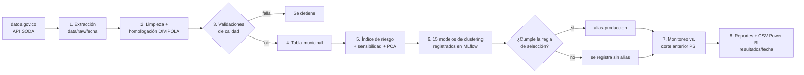
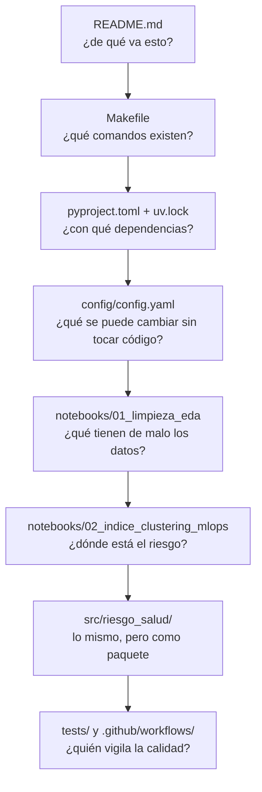

# Riesgo de acceso a la salud por municipio en Colombia

Proyecto 2 · Especialización en Ciencia de Datos e Inteligencia Artificial · Universidad de Medellín

**Problema.** En muchos municipios, la población depende de EPS en crisis (intervenidas por
la Supersalud) y tiene poca oferta de IPS. Si esa EPS falla, la gente se queda sin acceso a
la salud.

**Objetivo.** Identificar y priorizar los municipios con mayor riesgo de acceso. Para eso se
integran tres fuentes oficiales, se construye un índice de riesgo de 0 a 100 y se agrupan los
municipios con modelos de clustering, todo dentro de un flujo de MLOps reproducible y
automatizado.

## Fuentes (datos abiertos, datos.gov.co, licencia CC BY-SA 4.0)

| Base | Entidad | ID | Uso |
|---|---|---|---|
| BDUA contributivo y subsidiado | ADRES | `tq4m-hmg2`, `d7a5-cnra` | Demanda: afiliados por EPS y municipio |
| Registro Especial de Prestadores (REPS) | MinSalud | `c36g-9fc2` | Oferta: sedes de IPS por municipio |
| DIVIPOLA | DANE | `gdxc-w37w` | Llave de integración y coordenadas |

## Cómo funciona



## Puesta en marcha (VS Code o cualquier terminal)

Requisitos: [uv](https://docs.astral.sh/uv/) (`winget install astral-sh.uv`) y, opcional,
`make` (`winget install ezwinports.make`; después hay que reabrir la terminal).

```bash
git clone https://github.com/DABO-lab/riesgo-acceso-salud.git
cd riesgo-acceso-salud
make setup        # sin make: uv sync  y  uv run pre-commit install
```
Instala las versiones exactas del `uv.lock` (con Python 3.12) en `.venv/` y activa los hooks.
En VS Code, elija `.venv` como intérprete y como kernel de los notebooks.

| Comando | Sin make | Qué hace |
|---|---|---|
| `make pipeline` | `uv run python -m riesgo_salud.pipeline` | Pipeline completo con datos reales del corte de hoy (usa la caché si ya se descargó) |
| `make pipeline FECHA=2026-10-25` | `... pipeline --fecha 2026-10-25` | Un corte específico |
| `make demo` | `... pipeline --demo --rapido` | El mismo pipeline con datos sintéticos, sin internet |
| `make mlflow` | `uv run mlflow ui --backend-store-uri sqlite:///mlflow/mlflow.db --port 5001` | Interfaz de MLflow en http://127.0.0.1:5001 |
| `make api` | `uv run uvicorn riesgo_salud.api.main:app --port 8000` | API de predicción en http://127.0.0.1:8000 (contrato en `/docs`) |
| `make test` | `uv run pytest -q` | Pruebas (sin internet) |
| `make lint` | `uv run ruff check . --fix` y `uv run ruff format .` | Estilo del código |
| `make notebook` | `uv run jupyter lab notebooks/` | Notebooks narrados |
| `make docker-build` / `make docker-run` | | El pipeline dentro de un contenedor |
| `make api-build` / `make api-run` | | La API dentro de un contenedor, con el modelo del último corte adentro |

**En Colab** también funciona: se clona el repo, `pip install -e .` y se fija
`os.environ["RIESGO_BASE_DIR"] = "/content/drive/MyDrive/proyecto2_salud"` para que datos,
resultados y MLflow queden en Drive.

## Cómo leer este repositorio



Los notebooks **explican**; el paquete **ejecuta**. Los notebooks importan las funciones de
`src/riesgo_salud/` en lugar de copiarlas.

```text
config/config.yaml        todos los parámetros (EPS intervenidas, pesos, modelos, umbrales)
src/riesgo_salud/         un módulo por etapa
    extraccion.py  limpieza.py  validacion.py  features.py  indice.py
    modelado.py    tracking.py  monitoreo.py   reportes.py  pipeline.py  sintetico.py
notebooks/
    01_limpieza_eda.ipynb             fase 1: extracción, limpieza y EDA, explicados
    02_indice_clustering_mlops.ipynb  fase 2: índice, clustering, MLflow y monitoreo
tests/                    pruebas automáticas (pytest), con controles negativos
resultados/<fecha>/       salidas de cada corte (se versionan: son pequeñas)
data/, mlflow/            datos crudos/limpios y experimentos (no se versionan)
docs/                     ficha del modelo, arquitectura, decisiones, diccionario, Power BI
.github/workflows/        pruebas en cada cambio + ejecución mensual automática
```

## Prácticas de MLOps

| Práctica | Dónde |
|---|---|
| Entorno reproducible: versiones exactas y misma versión de Python | `uv.lock`, `.python-version`, `make setup` |
| Comandos del proyecto en un solo lugar | `Makefile` |
| Configuración separada del código | `config/config.yaml` |
| Datos versionados por fecha de corte, con metadatos de cada descarga | `data/raw/<fecha>/metadatos_corte.json` |
| Contratos de datos que detienen el pipeline | `validacion.py` → `resultados/<fecha>/calidad.json` |
| Seguimiento de experimentos (parámetros, métricas, figuras) | MLflow, `tracking.py` |
| Registro del modelo con firma y **promoción controlada** al alias `produccion` | MLflow Model Registry |
| Hooks en cada commit: estilo y notebooks sin salidas | `.pre-commit-config.yaml` (ruff + nbstripout) |
| Pruebas y pipeline demo en cada cambio | `tests/` + `.github/workflows/ci.yml` |
| Ejecución programada cada mes | `.github/workflows/pipeline_mensual.yml` |
| Monitoreo de cambios entre cortes (PSI) y regla de reentrenamiento | `monitoreo.py` → `monitoreo.md` |
| Servicio de predicción con contrato validado y health check | `src/riesgo_salud/api/` (FastAPI + Pydantic) |
| Contenedores sin root para el pipeline y para la API | `Dockerfile`, `Dockerfile.api` |
| Documentación del modelo | `docs/ficha_modelo.md` |

## API de predicción

`make api` levanta un servicio con FastAPI sobre los resultados del último corte
(`resultados/<fecha>/`): la tabla de municipios y el modelo de grupos de ese corte. En
http://127.0.0.1:8000 hay una página para consultar municipios y en `/docs` el contrato
interactivo.

| Endpoint | Qué hace |
|---|---|
| `GET /health` | Readiness: datos cargados y el modelo predice un municipio conocido |
| `GET /municipios/{cod_mpio}` | Índice, nivel, ranking y grupo de un municipio (código DIVIPOLA) |
| `GET /municipios?dpto=&nivel=&buscar=&limite=` | Ranking nacional con filtros |
| `POST /predict` | Riesgo que tendría un municipio con ciertos indicadores (escenarios) |
| `POST /predict/batch` | Lo mismo para varios municipios |

Ejemplo desde PowerShell (¿qué pasa con Argelia si su EPS principal deja de estar intervenida?):

```powershell
$body = @{ pct_intervenidas = 0.17; hhi = 7138; ips_x_10mil = 0.74; pct_rural = 0.81; pct_subsidiado = 0.97 } | ConvertTo-Json
Invoke-RestMethod -Method Post -Uri http://127.0.0.1:8000/predict -ContentType application/json -Body $body
```

`POST /predict` ubica cada indicador en el percentil que tendría entre los municipios del
corte, con la misma regla del índice: para un municipio existente devuelve exactamente su
índice. El grupo lo asigna el modelo registrado. Para usar el modelo del Model Registry en
lugar del archivo del corte: `MODELO_URI=models:/clusters-riesgo-municipal@produccion`.

## Resultados (corte del 29 de octubre de 2026)

- **42,3 %** de los afiliados del país (21,2 millones) está en una EPS intervenida; en 702 de
  1.122 municipios es la mitad o más.
- El índice ubica **113 municipios en nivel "Muy alto"** (1,4 millones de afiliados), sobre
  todo en Santander, Boyacá, Caquetá, Cauca y Valle del Cauca. Los primeros del ranking son
  Argelia (Cauca), Leiva (Nariño) y Mogotes (Santander).
- El ranking es estable ante cambios de pesos (Spearman mediano 0,983), pero los pesos de
  PCA lo cambian bastante (0,63): los pesos son una decisión del equipo, documentada en la
  ficha del modelo.
- Clustering: **K-means con k = 3** (estabilidad 0,82, silhouette 0,24). Tres perfiles: rural
  y dependiente de EPS intervenidas (446 municipios), subsidiado con EPS no intervenidas (388)
  y urbano contributivo (288).

Detalle en `resultados/<fecha>/resumen.md` y en el notebook 02.

## Decisiones del equipo
- Se trabaja con **todo el país** (1.122 municipios). Antioquia se analiza como zoom.
- **EPS intervenidas:** Nueva EPS, Coosalud, Emssanar, Asmet Salud, Famisanar, SOS y Capresoca
  (listado de octubre de 2026). Savia Salud no se incluye.
- **Modelo no supervisado** (índice + clustering), porque no existe una variable que indique
  "este municipio perdió acceso".

Más en [docs/decisiones-y-datos.md](docs/decisiones-y-datos.md) y [docs/ficha_modelo.md](docs/ficha_modelo.md).

## Trabajo en equipo

`main` siempre debe correr. Cada cambio va en una rama y entra por *pull request*, donde
GitHub Actions corre las pruebas antes de unir:

```bash
git switch -c feature/mi-cambio
git add . && git commit -m "Describe el cambio"
git push -u origin feature/mi-cambio
```
