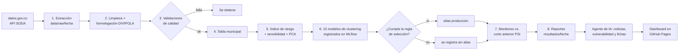
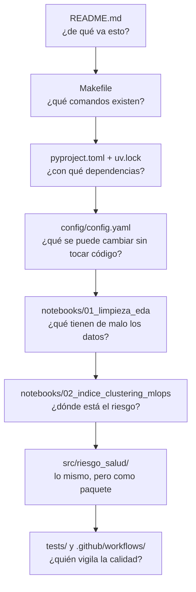
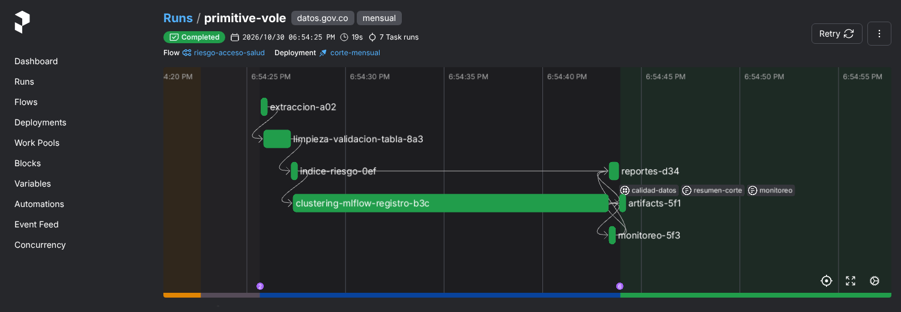

# Riesgo de acceso a la salud por municipio en Colombia

Proyecto 2 · Especialización en Ciencia de Datos e Inteligencia Artificial · Universidad de Medellín

**Problema.** En muchos municipios, la población depende de EPS en crisis (intervenidas por
la Supersalud) y tiene poca oferta de IPS. Si esa EPS falla, la gente se queda sin acceso a
la salud.

**Objetivo.** Identificar y priorizar los municipios con mayor riesgo de acceso. Para eso se
integran tres fuentes oficiales, se construye un índice de riesgo de 0 a 100 y se agrupan los
municipios con modelos de clustering, todo dentro de un flujo de MLOps reproducible y
automatizado. Un agente de IA contrasta cada corte con fuentes externas (noticias y
vulnerabilidad social) y los resultados se publican solos en un dashboard web.

**Dashboard en línea:** https://dabo-lab.github.io/riesgo-acceso-salud/

## Fuentes (datos abiertos, datos.gov.co, licencia CC BY-SA 4.0)

| Base | Entidad | ID | Uso |
|---|---|---|---|
| BDUA contributivo y subsidiado | ADRES | `tq4m-hmg2`, `d7a5-cnra` | Demanda: afiliados por EPS y municipio |
| Registro Especial de Prestadores (REPS) | MinSalud | `c36g-9fc2` | Oferta: sedes de IPS por municipio |
| DIVIPOLA | DANE | `gdxc-w37w` | Llave de integración y coordenadas |

Fuentes del contraste externo (paso del agente de IA):

| Fuente | Entidad | Uso |
|---|---|---|
| Pobreza multidimensional municipal, censo 2018 (anexo xlsx) | DANE | IPM y barreras de acceso a salud por municipio |
| Municipios PDET (`idrk-ba8y`, datos.gov.co) | Agencia de Renovación del Territorio | 170 municipios del posconflicto |
| Google Noticias (RSS) | Medios de comunicación | Noticias del último mes sobre las EPS intervenidas |
| Gemini, nivel gratuito | Google | Clasifica titulares y redacta lecturas y fichas (no calcula) |

## Cómo funciona



Si el agente de IA falla o no hay clave, el corte se publica igual: es complementario.

## Puesta en marcha (VS Code o cualquier terminal)

Requisitos: [uv](https://docs.astral.sh/uv/) (`winget install astral-sh.uv`) y, opcional,
`make` (`winget install ezwinports.make`; después hay que reabrir la terminal).

```bash
git clone https://github.com/DABO-lab/riesgo-acceso-salud.git
cd riesgo-acceso-salud
make setup        # sin make: uv sync  y  uv run pre-commit install
```
Instala las versiones exactas del `uv.lock` (con Python 3.12) en `.venv/` y activa los hooks.
En VS Code, elija `.venv` como intérprete y como kernel de los notebooks.

| Comando | Sin make | Qué hace |
|---|---|---|
| `make pipeline` | `uv run python -m riesgo_salud.pipeline` | Pipeline completo con datos reales del corte de hoy (usa la caché si ya se descargó) |
| `make pipeline FECHA=2026-10-25` | `... pipeline --fecha 2026-10-25` | Un corte específico |
| `make flujo` | `uv run python -m riesgo_salud.flujo` | El mismo pipeline orquestado con Prefect (una task por etapa, reintentos, artifacts) |
| `make demo` | `... pipeline --demo --rapido` | El mismo pipeline con datos sintéticos, sin internet |
| `make mlflow` | `uv run mlflow ui --backend-store-uri sqlite:///mlflow/mlflow.db --port 5001` | Interfaz de MLflow en http://127.0.0.1:5001 |
| `make api` | `uv run uvicorn riesgo_salud.api.main:app --port 8000` | API de predicción en http://127.0.0.1:8000 (contrato en `/docs`) |
| `uv run python -m riesgo_salud.noticias --fecha AAAA-MM-DD` | | Agente de noticias sobre un corte ya calculado (requiere `GEMINI_API_KEY`) |
| `uv run python -m riesgo_salud.validar_ia preparar\|evaluar --fecha AAAA-MM-DD` | | Muestra para revisar a mano la clasificación de la IA y medición del acuerdo |
| `make dashboard` | `uv run python dashboard/construir.py` y `uv run python -m http.server 8080 --directory _site` | Dashboard web en http://localhost:8080 (el mismo que se publica en GitHub Pages) |
| `make test` | `uv run pytest -q` | Pruebas (sin internet) |
| `make lint` | `uv run ruff check . --fix` y `uv run ruff format .` | Estilo del código |
| `make notebook` | `uv run jupyter lab notebooks/` | Notebooks narrados |
| `make docker-build` / `make docker-run` | | El pipeline dentro de un contenedor |
| `make api-build` / `make api-run` | | La API dentro de un contenedor, con el modelo del último corte adentro |

**En Colab** también funciona: se clona el repo, `pip install -e .` y se fija
`os.environ["RIESGO_BASE_DIR"] = "/content/drive/MyDrive/proyecto2_salud"` para que datos,
resultados y MLflow queden en Drive.

## Dashboard en línea

**https://dabo-lab.github.io/riesgo-acceso-salud/**

Mapa, ranking, departamentos, grupos del clustering, validaciones de calidad, monitoreo y auditoría
de equidad del último corte, con filtros y selector para consultar cortes anteriores. También
muestra lo que produce el agente de IA: contraste con noticias, hipótesis de vulnerabilidad
social y fichas de los 5 municipios de mayor riesgo.

Se actualiza solo: cuando el pipeline mensual termina bien y guarda `resultados/<fecha>/`, el
workflow `Dashboard` (`.github/workflows/dashboard.yml`) arma el sitio con `dashboard/construir.py`
y lo publica en GitHub Pages. Si una validación crítica falla, el pipeline se detiene, no se
publica nada y el tablero sigue mostrando el último corte válido. El botón **Ejecutar nuevo corte**
abre el pipeline en GitHub Actions ("Run workflow", solo colaboradores del repositorio) y el
recuadro de estado consulta en vivo si la última ejecución terminó, falló o sigue corriendo.

## Agente de noticias (IA)

Después de calcular el corte, `src/riesgo_salud/noticias.py` contrasta el índice con la prensa del
último mes. Las tareas están separadas para que el resultado se pueda verificar:

1. **Buscar (código):** noticias de Google Noticias sobre las 7 EPS intervenidas y la crisis de salud,
   con consultas nacionales iguales para todo el país.
2. **Leer y clasificar (IA, Gemini, nivel gratuito):** EPS, departamentos, municipios, tipo de problema
   y gravedad de cada noticia. Se guarda el enlace como evidencia.
3. **Contrastar (código):** menciones por departamento frente al índice, con la correlación de Spearman
   y un control por tamaño de la población. Clasifica los departamentos en *coinciden*, *riesgo
   silencioso* (riesgo alto sin noticias) y *posible punto ciego* (noticias con riesgo bajo).
   La IA solo redacta el resumen con esas cifras.

Salidas: `resultados/<fecha>/contraste_noticias.json` y `noticias.json`, visibles en el dashboard.
Requiere la clave `GEMINI_API_KEY` (en GitHub: *Settings → Secrets and variables → Actions*). Sin
clave, o si algo falla, la etapa se omite y el corte se publica igual. Para un corte ya calculado:
`uv run python -m riesgo_salud.noticias --fecha 2026-11-05`.

### Vulnerabilidad social, fichas y validación de la IA

El mismo paso del agente hace tres cosas más:

- **Cruce con vulnerabilidad social** (`vulnerabilidad.py`): descarga el IPM municipal del DANE (censo
  2018) y los 170 municipios PDET (Agencia de Renovación del Territorio) y evalúa cuatro hipótesis
  **registradas antes de ver los datos** en `config.yaml` (`vulnerabilidad.rubrica`, 2026-11-12):
  H1 pobreza, H2 PDET, H3 barreras de acceso a salud y H4 doble vulnerabilidad. Cada una tiene su
  prueba (Spearman, Fisher, binomial) y su umbral. Sale en `vulnerabilidad.json`.
- **Fichas de los 5 municipios de mayor riesgo** (`fichas.py`): el agente las redacta solo con los
  datos del corte (índice, componentes, EPS, IPS, pobreza, PDET y noticias). Sin clave, usa una plantilla.
- **Validación de la IA** (`validar_ia.py`): una muestra de 30 noticias se revisa a mano y se mide el
  acuerdo con la clasificación de Gemini (acuerdo y kappa de Cohen):

  ```bash
  uv run python -m riesgo_salud.validar_ia preparar --fecha 2026-11-12   # crea la muestra en Excel
  # llenar las columnas humano_relevante, humano_departamentos y humano_tipo
  uv run python -m riesgo_salud.validar_ia evaluar --fecha 2026-11-12    # crea validacion_ia.json
  ```

## Cómo leer este repositorio



Los notebooks **explican**; el paquete **ejecuta**. Los notebooks importan las funciones de
`src/riesgo_salud/` en lugar de copiarlas.

```text
config/config.yaml        todos los parámetros (EPS intervenidas, pesos, modelos, umbrales)
src/riesgo_salud/         un módulo por etapa
    extraccion.py  limpieza.py  validacion.py  features.py  indice.py
    modelado.py    tracking.py  monitoreo.py   reportes.py  equidad.py   sintetico.py
    pipeline.py    flujo.py (Prefect)          api/ (FastAPI)
    noticias.py    vulnerabilidad.py  fichas.py  validar_ia.py   (agente de IA)
dashboard/                página web del dashboard y construir.py (arma el sitio de GitHub Pages)
notebooks/
    01_limpieza_eda.ipynb             fase 1: extracción, limpieza y EDA, explicados
    02_indice_clustering_mlops.ipynb  fase 2: índice, clustering, MLflow y monitoreo
tests/                    pruebas automáticas (pytest), con controles negativos
resultados/<fecha>/       salidas de cada corte (se versionan: son pequeñas)
data/, mlflow/            datos crudos/limpios y experimentos (no se versionan)
docs/                     ficha del modelo, ética y usuario, arquitectura, decisiones, Power BI (opcional)
.github/workflows/        pruebas en cada cambio, ejecución mensual y publicación del dashboard
```

## Prácticas de MLOps

| Práctica | Dónde |
|---|---|
| Entorno reproducible: versiones exactas y misma versión de Python | `uv.lock`, `.python-version`, `make setup` |
| Comandos del proyecto en un solo lugar | `Makefile` |
| Configuración separada del código | `config/config.yaml` |
| Datos versionados por fecha de corte, con metadatos de cada descarga | `data/raw/<fecha>/metadatos_corte.json` |
| Contratos de datos que detienen el pipeline | `validacion.py` → `resultados/<fecha>/calidad.json` |
| Seguimiento de experimentos (parámetros, métricas, figuras) | MLflow, `tracking.py` |
| Registro del modelo con firma y **promoción controlada** al alias `produccion` | MLflow Model Registry |
| Hooks en cada commit: estilo y notebooks sin salidas | `.pre-commit-config.yaml` (ruff + nbstripout) |
| Pruebas y pipeline demo en cada cambio | `tests/` + `.github/workflows/ci.yml` |
| Orquestación: tasks con estado, reintentos en la descarga, artifacts y schedule | Prefect, `src/riesgo_salud/flujo.py` |
| Ejecución programada cada mes | `.github/workflows/pipeline_mensual.yml` (corre el flow de Prefect) |
| Monitoreo de cambios entre cortes (PSI) y regla de reentrenamiento | `monitoreo.py` → `monitoreo.md` |
| Auditoría de sesgos en cada corte (tamaño, oferta inflada, vulnerables en Bajo, incertidumbre) | `equidad.py` → `equidad.md`, métricas `eq_*` en MLflow |
| Servicio de predicción con contrato validado y health check | `src/riesgo_salud/api/` (FastAPI + Pydantic) |
| Contenedores sin root para el pipeline y para la API | `Dockerfile`, `Dockerfile.api` |
| Documentación del modelo, del usuario y de la ética | `docs/ficha_modelo.md`, `docs/etica_usuario_beneficio.md` |
| Publicación automática de resultados (despliegue continuo del tablero) | `dashboard/`, `.github/workflows/dashboard.yml` → GitHub Pages |
| IA acotada: el código busca y calcula, la IA solo clasifica y redacta | `noticias.py`, `vulnerabilidad.py`, `fichas.py` |
| Hipótesis registradas antes de ver los datos (rúbrica) | `config.yaml` → `vulnerabilidad.rubrica` |
| Validación humana de la IA (acuerdo y kappa de Cohen) | `validar_ia.py` → `validacion_ia.json` |
| Secretos fuera del código | `GEMINI_API_KEY` en *GitHub Secrets* |

## Orquestación con Prefect

`make flujo` corre el pipeline como un *flow* de Prefect: cada etapa es una *task* con estado,
logs y duración. Son las mismas funciones de `pipeline.py`, sin duplicar lógica.



- **Reintentos solo donde tienen sentido:** la descarga de datos.gov.co se reintenta 3 veces
  (10, 30 y 60 s). Un error de calidad de datos es determinista: detiene el flow y no se entrena.
- **Artifacts:** cada run publica la tabla de calidad, el resumen del corte y el monitoreo.
- **Idempotencia:** la fecha del corte es la llave; repetir un run reescribe `resultados/<fecha>/`.
- **Programación:** el día 5 de cada mes a las 8:00 (hora de Colombia). En GitHub Actions
  (`pipeline_mensual.yml`) o con un deployment local de Prefect:

```powershell
# Terminal 1: servidor e interfaz de Prefect en http://127.0.0.1:4200
make prefect-ui
# Terminal 2: registrar el deployment programado y dejarlo escuchando
$env:PREFECT_API_URL = "http://127.0.0.1:4200/api"
make flujo-programar
# Opcional, terminal 3: lanzar un run ya mismo
$env:PREFECT_API_URL = "http://127.0.0.1:4200/api"
uv run prefect deployment run "riesgo-acceso-salud/corte-mensual"
```

## API de predicción

`make api` levanta un servicio con FastAPI sobre los resultados del último corte
(`resultados/<fecha>/`): la tabla de municipios y el modelo de grupos de ese corte. En
http://127.0.0.1:8000 hay una página para consultar municipios y en `/docs` el contrato
interactivo.

| Endpoint | Qué hace |
|---|---|
| `GET /health` | Readiness: datos cargados y el modelo predice un municipio conocido |
| `GET /municipios/{cod_mpio}` | Índice, nivel, ranking y grupo de un municipio (código DIVIPOLA) |
| `GET /municipios?dpto=&nivel=&buscar=&limite=` | Ranking nacional con filtros |
| `POST /predict` | Riesgo que tendría un municipio con ciertos indicadores (escenarios) |
| `POST /predict/batch` | Lo mismo para varios municipios |

Ejemplo desde PowerShell (¿qué pasa con Argelia si su EPS principal deja de estar intervenida?):

```powershell
$body = @{ pct_intervenidas = 0.17; hhi = 7138; ips_x_10mil = 0.74; pct_rural = 0.81; pct_subsidiado = 0.97 } | ConvertTo-Json
Invoke-RestMethod -Method Post -Uri http://127.0.0.1:8000/predict -ContentType application/json -Body $body
```

`POST /predict` ubica cada indicador en el percentil que tendría entre los municipios del
corte, con la misma regla del índice: para un municipio existente devuelve exactamente su
índice. El grupo lo asigna el modelo registrado. Para usar el modelo del Model Registry en
lugar del archivo del corte: `MODELO_URI=models:/clusters-riesgo-municipal@produccion`.

## Resultados (corte del 12 de noviembre de 2026)

- **42,2 %** de los afiliados del país (unos 21 millones) está en una EPS intervenida.
- El índice ubica **113 municipios en nivel "Muy alto"** (1,44 millones de afiliados), sobre
  todo en Santander, Boyacá, Caquetá, Cauca y Valle del Cauca. Los primeros del ranking son
  Argelia (Cauca), Leiva (Nariño) y Mogotes (Santander).
- El ranking es estable ante cambios de pesos (Spearman mediano 0,983), pero los pesos de
  PCA lo cambian bastante (0,63): los pesos son una decisión del equipo, documentada en la
  ficha del modelo.
- Clustering: **K-means con k = 3** (estabilidad 0,83, silhouette 0,24). Tres perfiles: rural
  y dependiente de EPS intervenidas (450 municipios), subsidiado con EPS no intervenidas (388)
  y urbano contributivo (284).
- Monitoreo: frente al corte del 5 de noviembre, PSI = 0 (los datos de datos.gov.co no
  cambiaron en la semana); no hace falta reentrenar.

**Contraste externo (agente de IA)**
- **Noticias** (150 del último mes, 146 relevantes): no siguen al índice (Spearman −0,13, no
  significativa) sino al tamaño de la población (0,53, significativa). Coinciden Cauca y Norte de
  Santander; ocho departamentos de riesgo alto no aparecen en la prensa ("riesgo silencioso"):
  Vichada, Guaviare, Caquetá, Vaupés, Putumayo, Arauca, Amazonas y Huila.
- **Vulnerabilidad social** (rúbrica registrada el 2026-11-12, antes de ver los datos):
  - H1, pobreza (IPM): relación débil (Spearman 0,23, significativa, por debajo del umbral 0,30).
  - H2, municipios PDET: **se cumple**. 18,8 % de los PDET está en riesgo Muy alto frente a 8,5 %
    del resto (2,2 veces; Fisher p = 0,0001).
  - H3, barreras de acceso a salud (DANE 2018): no se cumple (0,04, no significativa).
  - H4, doble vulnerabilidad: no se cumple (52 municipios frente a 46 esperados).
  - Lectura: el índice no es otra medida de pobreza. El grupo 2 es incluso más pobre que el
    grupo 1 (IPM mediano 47 frente a 43); lo que los separa es la EPS.
- **Validación humana de la IA:** pendiente (muestra de 30 noticias en
  `resultados/2026-11-12/validacion_ia_muestra.xlsx`).

Detalle en `resultados/<fecha>/resumen.md` y en el notebook 02.

## Decisiones del equipo
- Se trabaja con **todo el país** (1.122 municipios). Antioquia se analiza como zoom.
- **EPS intervenidas:** Nueva EPS, Coosalud, Emssanar, Asmet Salud, Famisanar, SOS y Capresoca
  (listado de octubre de 2026). Savia Salud no se incluye.
- **Modelo no supervisado** (índice + clustering), porque no existe una variable que indique
  "este municipio perdió acceso".

- **Bajo no significa buen acceso:** el índice mide el riesgo que crea la intervención de EPS.
  Cada corte lista los municipios vulnerables que quedan en Bajo (`equidad.md`).

Más en [docs/decisiones-y-datos.md](docs/decisiones-y-datos.md), [docs/ficha_modelo.md](docs/ficha_modelo.md)
y [docs/etica_usuario_beneficio.md](docs/etica_usuario_beneficio.md) (usuario, beneficio, privacidad, sesgo e interpretabilidad).

## Trabajo en equipo

`main` siempre debe correr. Cada cambio va en una rama y entra por *pull request*, donde
GitHub Actions corre las pruebas antes de unir:

```bash
git switch -c feature/mi-cambio
git add . && git commit -m "Describe el cambio"
git push -u origin feature/mi-cambio
```
