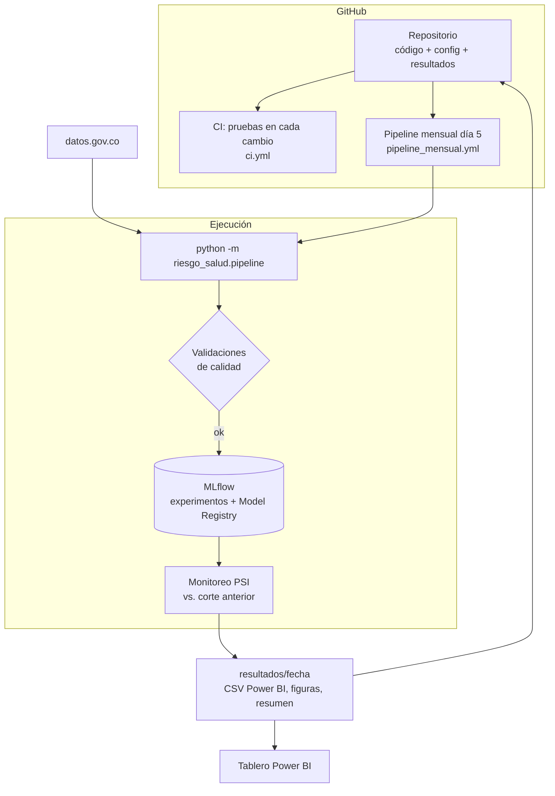

# Arquitectura MLOps

## Ciclo de vida de cada corte
1. **Disparo:** GitHub Actions lo lanza el día 5 de cada mes, o una persona lo lanza a mano con `make pipeline`, desde la pestaña *Actions* o desde el notebook 02.
2. **Extracción versionada:** los datos crudos se guardan en `data/raw/<fecha>/` con un archivo de metadatos que dice el origen, las filas descargadas y la lista de EPS intervenidas usada.
3. **Contratos de datos:** chequeos como el total de afiliados, el cruce DIVIPOLA o que todas las EPS intervenidas aparezcan. Si uno crítico falla, **no se entrena**.
4. **Entrenamiento y comparación:** 15 modelos, cada uno como un *run* de MLflow con sus parámetros y métricas.
5. **Selección y registro:** el mejor según la regla de la ficha del modelo se registra en el Model Registry. El alias `produccion` solo se le asigna si cumple la regla (promoción controlada).
6. **Monitoreo:** se compara con el corte anterior:
    - PSI por variable.
    - Municipios que cambian de nivel.
    - Concordancia (ARI) entre el modelo del mes anterior y el nuevo, como comparación campeón contra retador.
7. **Publicación:** los resultados se guardan en `resultados/<fecha>/` dentro del repositorio. GitHub Actions muestra el resumen en la página de la ejecución.

## Cómo leer el PSI
| PSI | Lectura | Acción |
|---|---|---|
| menos de 0,10 | estable | ninguna |
| 0,10 a 0,25 | cambio moderado | revisar |
| más de 0,25 | cambio fuerte | reentrenar y revisar la causa (por ejemplo, una nueva EPS intervenida) |

## Reproducibilidad del entorno
- `uv.lock` fija la versión exacta de cada dependencia. `uv sync --frozen` instala lo mismo en cada computador, en Docker y en GitHub Actions.
- `.python-version` fija Python 3.12.
- En cada `git commit`, `ruff` revisa el estilo y `nbstripout` borra las salidas de los notebooks.
- En cada push o pull request, `ci.yml` corre ruff, las pruebas y el pipeline en modo demo.
